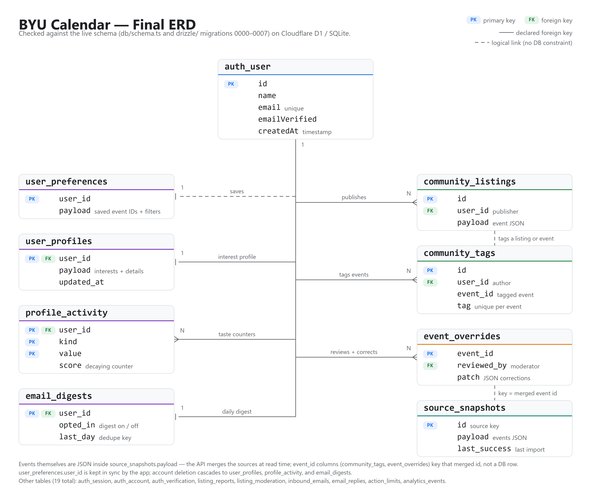

# BYU Calendar

A campus event calendar built with React, Vinext, and Cloudflare D1, using the colors and typography of CareerLaunchpad.

- Week, month, and responsive agenda views
- Public BYU, Marriott, AIS, Accounting Society, and department imports with source provenance
- A dated snapshot of 119 public listings from 48 student organizations
- A reviewed snapshot of 227 Handshake event listings, with organizer details and original links
- Phrase-based smart search and grouped interest/detail filters
- Account-specific saved events and named filters
- BYU email verification with immediate community listings/tags and private reports
- iCalendar export
- Personal picks: a chat-built interest profile with deterministic recommendations
- Persistent snapshots and automatic source refresh on visits and while open

See [maintenance and setup](docs/MAINTENANCE.md) for development, data sources, refresh behavior, and current limitations.

See [account setup](docs/ACCOUNTS.md) for permissions, database migrations, and email configuration.

## Data model

The site runs on 19 tables in Cloudflare D1 (SQLite). The schema is defined in `db/schema.ts` and created by the migrations in `drizzle/`. Final ERD:



Sample rows from nine of the tables: [docs/sample-rows.png](docs/sample-rows.png).

## Local preview

Requires Node 22.13 or newer.

```powershell
git clone https://github.com/Canar8ue/BYUCalendar.git
cd BYUCalendar
npm run install:ci                 # locked dependency install
node scripts/run-framework.mjs dev # dev app (read the actual preview port from the output)
```

The calendar loads with the checked-in seed data (`data/seed.json`); no environment configuration is needed to browse, search, filter, or export.

## Verification

`npm test`, `node node_modules/typescript/bin/tsc --noEmit`, `npm run build`, then `npm run test:worker`.

## Hosting

The calendar is self-hosted at https://byucalendar.com with Nginx, systemd, a local SQLite (Cloudflare D1) database, and a refresh cron every 20 minutes. See [the deployment runbook](deploy/DEPLOY.md).
